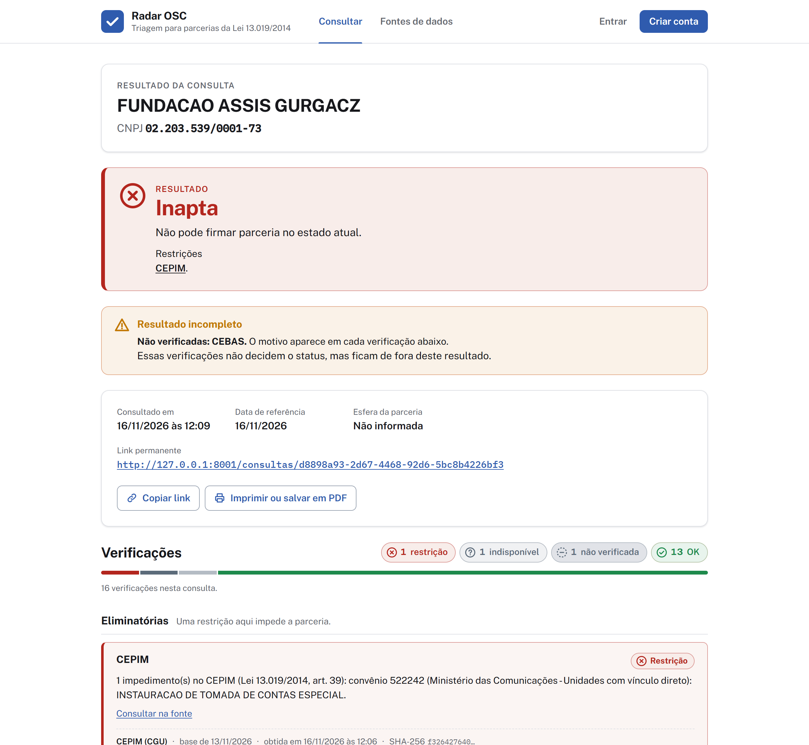
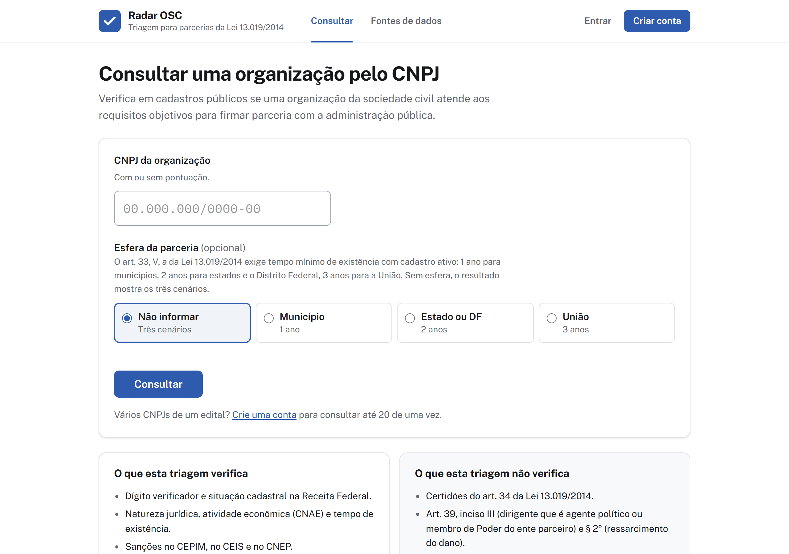
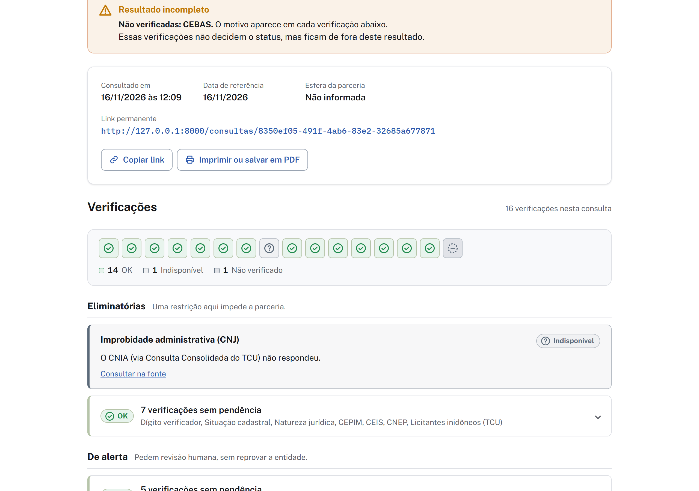
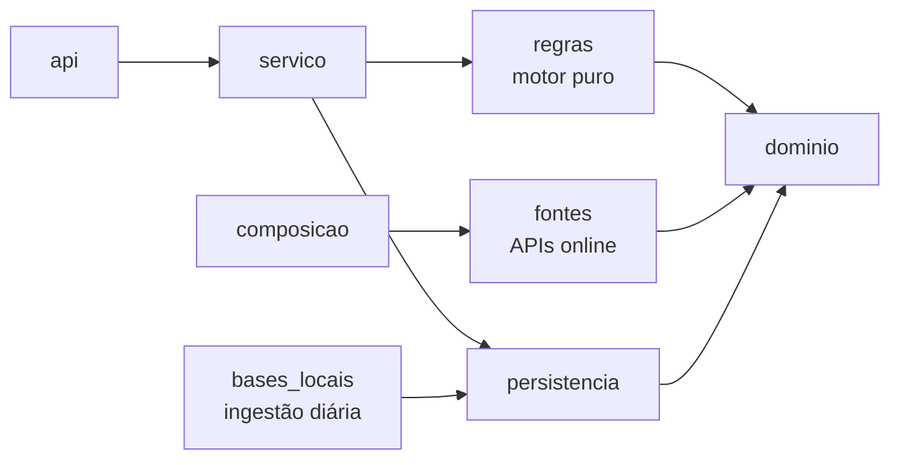
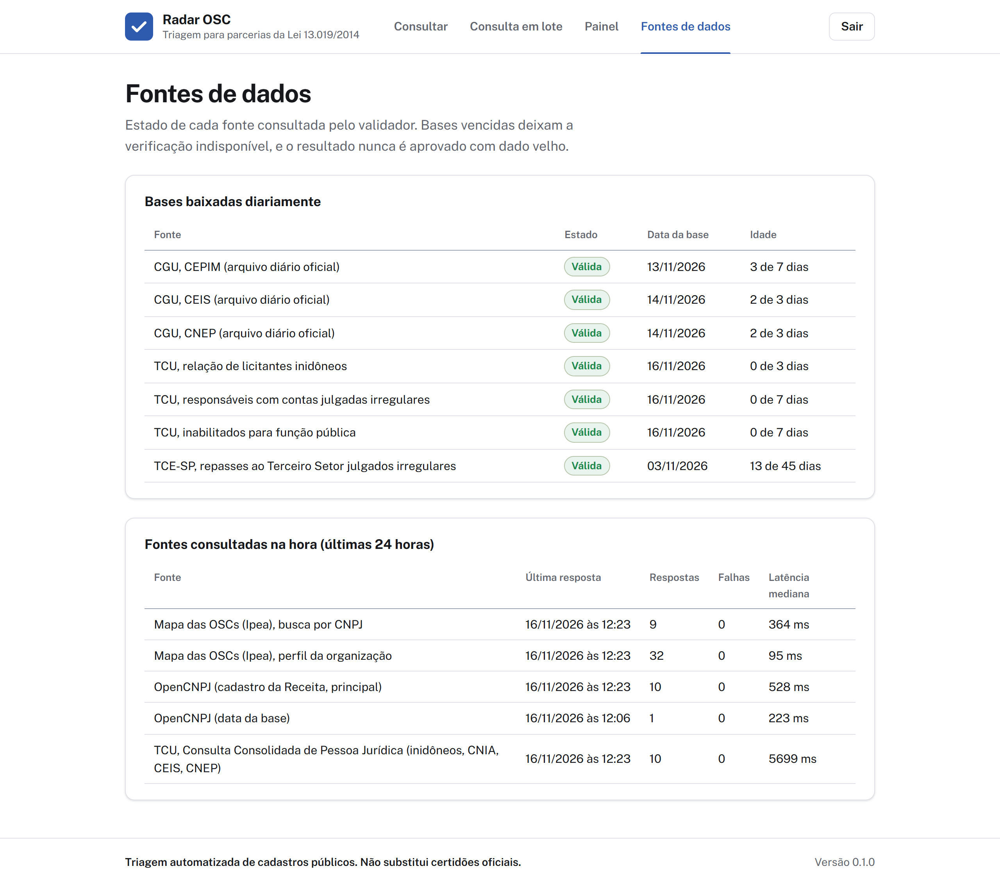

# Radar OSC

[](https://github.com/ralphsblue/Radar-OSC/actions/workflows/ci.yml)


[](LICENSE)

**Triagem automatizada de CNPJ para parcerias com o poder público, conforme o Marco Regulatório das Organizações da Sociedade Civil (Lei 13.019/2014).**

Para firmar parceria com a administração pública, uma organização precisa ser uma OSC (art. 2º) e não pode estar impedida (art. 39).
Hoje essa checagem é feita à mão, site por site.
O Radar OSC cruza cadastros públicos em segundos e devolve um status (apta, apta com ressalvas, inconclusiva ou inapta), com a explicação de cada verificação, a fonte e a data de cada dado.

Projeto de extensão do IFSP.
É uma triagem: não substitui as certidões oficiais.



## Destaques

- **16 verificações sobre 6 fontes públicas:** Receita Federal, CGU (CEPIM, CEIS, CNEP), TCU, CNJ, TCE-SP e Mapa das OSCs do Ipea.
- **Nunca aprova por omissão:** se uma fonte eliminatória não responde ou uma base está vencida, o resultado é inconclusivo, nunca apto.
- **Rastreável:** toda resposta de fonte é guardada com hash SHA-256 e ligada à consulta como evidência; cada verificação tem link para conferir na fonte oficial.
- **Consulta em lote:** o ente público tria até 20 CNPJs de um edital de uma vez, processados de forma assíncrona numa fila (RQ + Redis), com filtro por status, exportação em CSV e painel de métricas.
- **Arquitetura verificada por máquina:** motor de regras puro, sem HTTP nem banco; 8 contratos do import-linter quebram o build se uma camada importar o que não deve.
- **1.300+ testes:** unidade, contrato com respostas reais gravadas, integração com PostgreSQL e ponta a ponta com as fontes em replay, sem rede.

## Para quem é

- **Ente público** (prefeitura, estado ou União): cria uma conta, tria as organizações candidatas de um edital em lote e acompanha o histórico num painel.
- **A própria OSC:** confere se está apta antes de concorrer e envia o link permanente do resultado ao órgão. Não precisa de conta.
- **Público em geral:** transparência sobre organizações que recebem recursos públicos.

## Como ler o resultado

| Status | Significado |
|---|---|
| Apta | Nada impede nas bases consultadas |
| Apta com ressalvas | Pode firmar parceria, mas há pontos para análise humana (por exemplo, atividade de baixa relevância social ou dirigente com possível sanção) |
| Inconclusiva | Uma verificação eliminatória não pôde ser feita (fonte fora do ar ou base vencida) |
| Inapta | Há um impedimento registrado (por exemplo, sanção vigente no CEIS ou natureza jurídica incompatível) |
| CNPJ inválido | Erro de digitação; nada foi consultado |

Cada verificação mostra o estado (OK, restrição, alerta, indisponível ou não verificado), a mensagem, a fonte, a data da base e o link oficial.
Regras, limitações e glossário estão em [docs/produto.md](docs/produto.md).

## O que é verificado

| Verificação | Fonte |
|---|---|
| Dígito verificador, situação cadastral, natureza jurídica, CNAE, organização religiosa, tempo de existência, filial e matriz | Receita Federal, via OpenCNPJ (reserva: BrasilAPI) |
| CEPIM, CEIS, CNEP | Arquivos diários oficiais da CGU, baixados para o banco |
| Licitantes inidôneos e improbidade (CNJ) | Consulta Consolidada do TCU e relação de inidôneos |
| Contas julgadas irregulares da própria OSC | TCU |
| Dirigentes do quadro de sócios | CEIS, CNEP, TCU (contas irregulares e inabilitados) e TCE-SP |
| Presença e perfil no Mapa das OSCs | Ipea |

O que a triagem não verifica (certidões do art. 34, sanções estaduais e municipais fora do CEIS, entre outros) aparece na própria página inicial.

<table>
  <tr>
    <td></td>
    <td></td>
  </tr>
  <tr>
    <td>Consulta por CNPJ, com a esfera da parceria.</td>
    <td>Se uma fonte eliminatória não responde, o resultado é inconclusivo, nunca apto.</td>
  </tr>
</table>

## Arquitetura



- Os adaptadores só coletam fatos; o motor de regras decide.
- Bases locais têm idade máxima: base vencida deixa a verificação indisponível.
- Cada CNPJ de um lote vira uma tarefa na fila; um worker separado consome a fila reaproveitando a mesma lógica da consulta individual.
- Erros da API seguem `application/problem+json` (RFC 9457).

Camadas, fluxos e o caminho completo de uma consulta em [docs/arquitetura.md](docs/arquitetura.md).

## Tecnologia

| Área | Ferramentas |
|---|---|
| Back-end | Python 3.14, FastAPI, Jinja2, httpx, pydantic, structlog |
| Dados | PostgreSQL 17, SQLAlchemy 2 (assíncrono), Alembic |
| Fila | Redis, RQ |
| Autenticação | JWT em cookie, bcrypt |
| Interface | HTML, CSS e JavaScript sem framework, pronta para impressão |
| Qualidade | uv, ruff, mypy estrito, import-linter, pytest, pre-commit, GitHub Actions |
| Deploy | Docker Compose, nginx, Let's Encrypt |

## Como rodar

Pré-requisitos: [uv](https://docs.astral.sh/uv/) e Docker.

```
uv sync
docker compose up -d --wait db redis
uv run alembic upgrade head
uv run validador-osc atualizar-bases
uv run validador-osc servir
```

Num segundo terminal, para processar consultas em lote:

```
uv run validador-osc trabalhar
```

A aplicação fica em http://127.0.0.1:8000 e a documentação interativa da API em http://127.0.0.1:8000/docs.
O banco local usa a porta 15432 e o Redis a porta 16379, fora das faixas que o Windows costuma reservar.

Para subir tudo em containers (app e worker inclusos): `docker compose --profile completo up -d --wait`.
O roteiro de produção em EC2, com nginx e HTTPS, está em [docs/deploy_ec2.md](docs/deploy_ec2.md).

### Bases locais

`validador-osc atualizar-bases` baixa as bases oficiais (CGU, TCU e TCE-SP), confere a integridade e troca a versão ativa de uma vez só.
Cada base tem idade máxima (em `validador_osc/dados/limites.json`); o estado de cada uma aparece em `/fontes`.



Agendamento diário: `.\scripts\agendar_atualizacao.ps1 -Horario 06:00` no Windows, ou cron com `uv run --no-sync validador-osc atualizar-bases` no Linux.

### Configuração

Variáveis com prefixo `VOSC_`, documentadas em `.env.example`.

| Variável | Uso |
|---|---|
| `VOSC_JWT_SEGREDO` | Assina o cookie de sessão; troque antes de qualquer uso real |
| `VOSC_TOKEN_OPERADOR` | Libera, no header `X-Token-Operador`, nomes de dirigentes com possível correspondência e evidências brutas |
| `VOSC_LIMITE_CONSULTAS_POR_MINUTO` | Limite de consultas por IP (0 desliga) |
| `VOSC_REDIS_URL` | Fila de processamento de lotes |

## API

| Método e rota | Descrição |
|---|---|
| `POST /api/v1/consultas` | Consulta um CNPJ: `{"cnpj": "...", "esfera": "municipio\|estado\|uniao", "atualizar": false}` |
| `GET /api/v1/consultas/{id}` | Resultado gravado (link permanente) |
| `GET /api/v1/fontes` | Estado das fontes online e das bases locais |
| `POST /api/v1/lotes` | Cria um lote de até 20 CNPJs separados por `;` (autenticado) |
| `GET /api/v1/lotes` e `GET /api/v1/lotes/{id}` | Histórico e status dos lotes (autenticado) |
| `GET /api/v1/lotes/{id}/export.csv` | Exporta o resultado do lote (autenticado) |
| `GET /api/v1/usuarios/me/metricas` | Métricas agregadas do usuário (autenticado) |

## Qualidade

```
uv run ruff check
uv run ruff format --check
uv run mypy
uv run lint-imports
uv run pytest
```

Os testes de integração e de ponta a ponta usam o banco `validador_teste`, criado automaticamente.
O CI roda tudo isso, mais o build da imagem Docker, a cada push.

## Documentação

| Documento | Conteúdo |
|---|---|
| [docs/produto.md](docs/produto.md) | Contexto, usuários, regras de decisão, limitações e glossário |
| [docs/produto_interface.md](docs/produto_interface.md) | Fluxo de lote, métricas, paleta, tipografia e disposição das telas |
| [docs/arquitetura.md](docs/arquitetura.md) | Camadas, regras de dependência, fluxos e mapa das pastas |
| [docs/especificacao.md](docs/especificacao.md) | Especificação funcional |
| [docs/decisoes.md](docs/decisoes.md) | Decisões de produto e engenharia, com data e motivo |
| [docs/roteiro_demonstracao.md](docs/roteiro_demonstracao.md) | Roteiro de demonstração com CNPJs de exemplo |
| [docs/deploy_ec2.md](docs/deploy_ec2.md) | Deploy em EC2 com Elastic IP, DuckDNS, nginx e Let's Encrypt |
| [docs/pesquisa/](docs/pesquisa/README.md) | Investigação de cada fonte de dados antes do código |

## In English

Radar OSC screens a Brazilian nonprofit's CNPJ (company registry number) against public registries to check whether it may sign partnerships with the government under Law 13.019/2014.
It cross-checks the federal company registry, federal sanction lists (CGU), the Federal Court of Accounts (TCU), the National Justice Council (CNJ), the São Paulo State Court of Accounts and the Ipea nonprofit map, and explains every check with its source and date.
The rules engine is pure and isolated from I/O, layer dependencies are enforced in CI with import-linter, every source response is stored with a SHA-256 hash as evidence, and a failing source never turns into an approval.
Government bodies can screen up to 20 CNPJs at once, processed asynchronously through a Redis-backed queue, and track batch history and aggregated metrics on a dashboard.
Stack: Python 3.14, FastAPI, async SQLAlchemy, PostgreSQL, Redis, RQ, httpx and plain HTML/CSS/JS, with 1,300+ tests including contract tests on recorded real responses and network-free end-to-end tests.

## Licença

[MIT](LICENSE).
